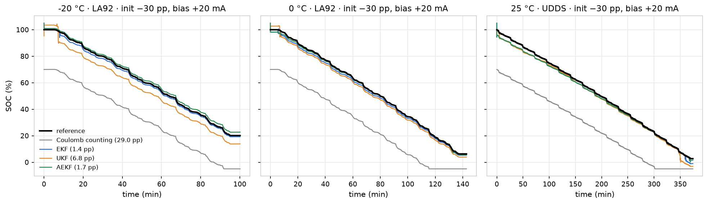
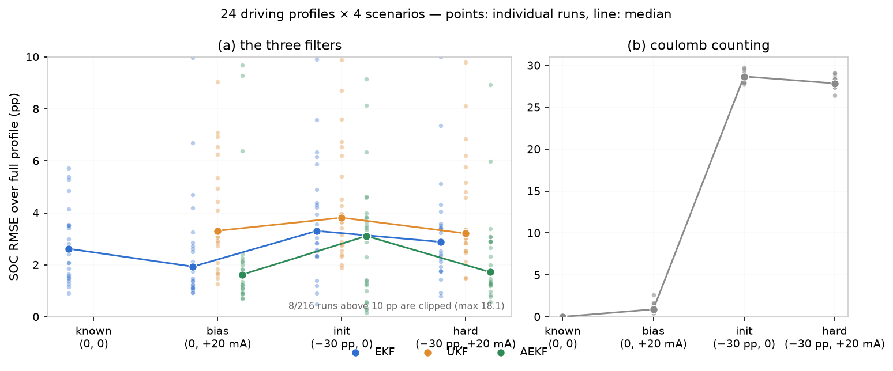

<div align="center">

# How Wrong Is Your SOC, and Why?

### A reusable EKF / UKF / AEKF package for battery state-of-charge, benchmarked on 24 driving profiles from −20 °C to 25 °C

[](https://github.com/ilo-love7/battery-soc-ekf-ukf/actions/workflows/ci.yml)
[](LICENSE)


<p align="center">
  <b>English</b> · <a href="./README.zh-CN.md">简体中文</a>
</p>

<p align="center">
  
</p>

</div>

---

One interface, four estimators (`CoulombCounter`, `EKF`, `UKF`, `AEKF`), and a benchmark that refuses to flatter itself: leave-one-profile-out calibration over 24 driving profiles × 4 stress scenarios × 2 chemistries. Every number in this README is regenerated by a command.

```
                                tail RMSE / full RMSE  (percentage points)
  scenario (init error, current bias)    CC        EKF       UKF      AEKF
  known      (  0 pp,    0 mA)        0.01/0.01  2.80/2.62    –        –
  bias20ma   (  0 pp,  +20 mA)        1.33/0.90  1.55/1.93 3.39/3.31 1.32/1.63
  init30     (−30 pp,    0 mA)       25.37/28.68 3.89/3.31 4.18/3.81 2.95/3.11
  hard       (−30 pp,  +20 mA)       24.65/27.86 2.23/2.88 3.14/3.21 1.79/1.72
```

**Four things worth knowing before you deploy a filter:**

1. **Model error is the floor, not the filter.** With a perfect initial SOC and a perfect current sensor, the EKF still sits at 2.62 pp, while pure coulomb counting gets 0.01 pp — because coulomb counting never looks at the model. The filter's job is not to be accurate; it is to *stop model error from becoming SOC error*.
2. **The only thing a filter buys you is a wrong initial SOC.** At −30 pp the EKF is 8.7× better than coulomb counting. At a 20 mA current bias, plain coulomb counting (0.90 pp) *beats* the EKF (1.93 pp). If your shunt is good, integration is hard to beat.
3. **AEKF wins consistently** (full-run 1.63–3.11 pp, tail 1.32–2.95 pp) and converges within 60 s on 92% of the `hard` profiles (EKF 50%, UKF 21%). But on `init30` — initial error only, no bias — it beats the EKF by just 0.2 pp. **Adaptive measurement noise fixes bias, not initialisation.**
4. **UKF has no systematic advantage**: it is slightly worse than the EKF in all three comparable scenarios, *after* two real bugs were found and fixed (§ *Why the UKF is not better*). Only then is the comparison worth publishing.

---

## Data

| Dataset | Role | Licence | Location |
|---|---|---|---|
| Panasonic 18650PF (Kollmeyer, McMaster/UW-Madison) | Main benchmark: NCA, 24 driving profiles, 5 temperature groups, HPPC | CC BY 4.0 | `PANASONIC_ROOT` (Mendeley doi 10.17632/wykht8y7tg.1) |
| CALCE A123 26650 (UMD) | Cross-chemistry transfer: LFP aged to ~45 % SOH, 24 segments, −10…50 °C | Public (UMD) | `CALCE_ROOT` (A123_*.zip) |

Both are read from local paths (`src/bmsoc/io_panasonic.py`, `scripts/10_calce_prepare.py`); tests never need them.

## Features

- **Four estimators behind one interface** — `CoulombCounter`, `EKF`, `UKF`, `AEKF`, all `run(profile) -> dict of arrays`. Same predict/measurement model, so the comparison is honest.
- **4th state = voltage bias.** A persistent model offset (20–50 mV on this data) is estimated online instead of being absorbed into SOC. This alone took the `known` floor from 3.87 → 2.15 pp.
- **Temperature-aware OCV.** `OCV(SOC, T)` with per-sample cell temperature — these tests cool the cell by 30 K *while driving*, so a single-temperature table is off by tens of mV.
- **Linear extrapolation outside SOC ∈ [0,1]** — required for UKF, harmless for EKF (see *Why the UKF is not better*).
- **Leave-one-profile-out calibration** and **four stress scenarios** instead of one flattering number.
- **154 unit tests, all on synthetic data** — they run without the datasets in CI (Python 3.10 + 3.12).

## Results

### Calibration quality (leave-one-profile-out, 24 folds)

| temperature | open-loop voltage RMSE on the held-out profile | median |
|---|---|---|
| 25 °C | 17.3 – 48.7 mV | 27.5 mV |
| 10 °C | 29.1 – 74.1 mV | 40.7 mV |
| 0 °C | 28.5 – 81.8 mV | 40.2 mV |
| −10 °C | 39.8 – 111.6 mV | 59.1 mV |
| −20 °C | 77.9 – 196.8 mV | 98.6 mV |

Median **52.6 mV**, P90 **99.8 mV**. Six electrical parameters are fitted per fold; the OCV table is *never* refitted (it comes from HPPC rests only), so this is a genuine out-of-profile test. The worst fold at every temperature is US06 — the most aggressive current profile.

### SOC accuracy

Full table with convergence shares and P90 in `reports/基准评测报告-A4.md` §7. Per-temperature medians for the hardest scenario (`hard`: −30 pp init + 20 mA bias):

| | −20 °C | −10 °C | 0 °C | 10 °C | 25 °C |
|---|---|---|---|---|---|
| CC | 29.07 | 28.35 | 27.48 | 27.76 | 27.53 |
| EKF | 1.76 | 3.23 | 2.35 | 4.06 | 2.48 |
| UKF | 5.16 | 3.34 | 3.23 | 3.19 | 2.68 |
| AEKF | 1.71 | **1.31** | **1.21** | **2.91** | 2.61 |

The temperature dependence is **not monotonic**: 10 °C is the worst (EKF 4.06 pp), because the 10 °C files cool from 23.7 °C down to 12 °C — the widest span — while the fold parameters are fitted at a single temperature. And at 10 °C *all five* profiles land in 3.4–4.3 pp, so this is a systematic offset, not an outlier. **Accuracy is governed by model error ÷ OCV slope — and both terms grow together in the cold, so cold is not automatically easier.**

<p align="center">
  
</p>

Figures: `docs/figures/` — OCV table & observability, LOO residuals, SOC tracking, error distribution, bias-state convergence, sensitivity, error CDF.

### Cross-chemistry: LFP (CALCE A123)

The same estimators, the same hyper-parameters and the same four scenarios, run **unchanged** on a second dataset — 24 segments, 8 temperatures (−10…50 °C), only the data layer swapped. Full section in `reports/基准评测报告-A4.md` §10.

| scenario | cc | EKF | UKF | AEKF |
|---|---|---|---|---|
| `known` (0, 0 A) | 0.01 | **0.24** | – | – |
| `bias20ma` | 2.16 | 1.96 | 1.87 | 1.95 |
| `init30` | 28.13 | 0.99 | **0.56** | 1.10 |
| `hard` | 26.90 | 1.35 | 1.98 | **1.29** |

LFP is **not harder** here (0.2–2.0 pp vs 2.6–3.3 pp for NCA), and the reasons are measurable rather than lucky:

- every segment starts at 100 % SOC, where the LFP curve is steep (30 pp ↔ 285 mV);
- the plateau's SOC gain is tiny — `K_soc` 0.0002 vs 0.0046 for NCA, 23× — so neither model error nor an OCV-table error moves the estimate.

What does bite, on both chemistries, is a **capacity** error: 5 % → 2–4.5 pp, 10 % → 5–7.4 pp, and no filter state can absorb a *gain* error. By contrast a ±40 mV OCV-table error (constant or SOC-shaped) costs ≤ 0.6 pp, because the bias state absorbs it.

## Quick start

```bash
git clone https://github.com/ilo-love7/battery-soc-ekf-ukf.git
cd battery-soc-ekf-ukf
python -m venv .venv && .venv/Scripts/pip install -r requirements.txt   # Windows
# numpy pandas pyarrow scipy openpyxl matplotlib pytest

python -m pytest tests -q                        # 154 tests, no dataset needed
```

```python
import sys; sys.path.insert(0, "src")
import numpy as np, pandas as pd
from bmsoc.ecm import RCParams
from bmsoc.filters import EKF, AEKF, FilterConfig
from bmsoc.ocv import OCV2D, OCVCurve, OCVTable, from_rest_points
from bmsoc.profiles import DrivingProfile

# 1) an OCV table (or load results/metrics/ocv_panasonic.json)
soc = np.linspace(0, 1, 11)
curve = from_rest_points(soc, 3.1 + 1.0 * soc, temp_c=25.0)
ocv2d = OCV2D(OCVTable({25.0: curve}))

# 2) a driving profile: t_s / current_a / voltage_v / temp_c / soc_ref / capacity_ah
prof = DrivingProfile(t_s=np.arange(n) * 1.0, current_a=i, voltage_v=v,
                      temp_c=np.full(n, 25.0), soc_ref=soc_ref, capacity_ah=2.77)

# 3) estimate
est = EKF(ocv=ocv2d, params=RCParams(r0=0.030, r1=0.008, tau1=12.0,
                                     r2=0.060, tau2=2000.0, dv=0.0),
          capacity_ah=2.77, cfg=FilterConfig(soc0=0.70, sigma_soc0=0.20))
out = est.run(prof, current_bias_a=0.02)
out["soc_hat"], out["bias_hat"], out["sigma_soc"]
```

## Bring your own data

You only need a `DrivingProfile`. `bmsoc.profiles.build_profile(t_s, current_a, voltage_v, temp_c, capacity_ah, soc0=1.0, dt=1.0)` resamples any irregular log to a fixed grid and builds the reference SOC by coulomb counting.

**Sign convention: charge positive, discharge negative.** If your logger is the other way round, flip the current *and* the OCV curve's direction, or the filter will happily converge to garbage.

## How it works

```
HPPC pulses ──► OCV(SOC,T) ─┐
                            ├──► 2-RC parameters ──► LOO calibration ──► filters ──► SOC
driving cycle ──────────────┘  (ECM-RUL project)      (this repo)      (this repo)
```

State `x = [soc, u1, u2, b]`:

```
soc[k+1] = soc[k] + η·i[k]·Δt / (3600·Q)
u_j[k+1] = e_j·u_j[k] + R_j(1−e_j)·i[k],   e_j = exp(−Δt/τ_j)
V[k]     = OCV(soc[k], T[k]) + u1[k] + u2[k] + R0·i[k] + dv + b[k]
```

OCV comes from HPPC rest-end voltages, PAVA-monotonised and then **smoothed with a 1.5 mV residual target**. Smoothing is not cosmetic: each HPPC SOC level contributes 5 pulses at almost the same SOC (0.005 apart) whose rest-end voltages differ by only 0.6–8 mV — replicates, not slope. At −20 °C, 25 of 35 adjacent pairs are *identical* (0.1 mV logger resolution), so PAVA turns the curve into a staircase and PCHIP through it gives `dOCV/dSOC` oscillating between **0.00 and 2.91 V/unit** (flat between steps means zero Kalman gain — the filter simply stops updating). After smoothing: **0.43–2.95**, median/min ratio down from 10⁵ to 2.1.

RC parameters are identified with **variable projection** (τ on a grid, `[R0,R1,R2]` by NNLS) over **5 stacked C-rates per SOC level** — a single 10 s pulse cannot separate two time constants (`τ2` pinned to the 5000 s bound, `τ1` jumping 5–67 s).

## Three traps in this dataset

**1. Resampling filled 55% of the voltage samples with the wrong value.** Low-temperature files start with a 2 h chamber soak logged at 60 s. Resampling to 1 s leaves 59 of every 60 bins empty, and the fill logic used *the mean of all valid voltages* instead of the previous value. The 4.17 V rest became 3.47 V for 7080 of 12850 samples, and the EKF diverged to 86.9 pp. Fixed to zero-order hold; the same profile is now 1.77 pp, and the `known` floor dropped 7.05 → 2.62 pp. Regression test: `tests/test_profiles.py::test_resample_holds_value_across_sparse_gaps`.

**2. The nominal temperature is not the cell temperature.** The 10 °C group runs from 23.7 → 12 °C; the −20 °C group from 16.1 → −16.3 °C. Hence `OCV(SOC, T)` queried with the measured cell temperature at every step.

**3. The capacity basis must be shared.** The OCV SOC axis and the reference SOC must use the same `Q_ref` (HPPC full discharge: 2.773 / 2.622 / 2.476 / 2.330 / 2.182 Ah at 25/10/0/−10/−20 °C). Mixing them produced a 133 mV "model error" that was pure bookkeeping. Also: profiles are trimmed to keep at most 300 s of leading rest, otherwise a 55%-of-samples flat soak dilutes every RMSE.

## Why the UKF is not better

Two real bugs, both worth knowing if you implement a UKF yourself.

**(a) `wm[0] = 0` but `wc[0] = β = 2`.** With `alpha=1, kappa=0, n=4` you get `λ = 0`, so the centre sigma point has zero weight in the mean and weight 2 in the covariance. For a linear measurement this cancels; for a nonlinear one `dY[0]` *is* the unscented-transform mean bias, and `wc[0]·dY[0]²` inflates `S`:

| SOC | σ=0.05 | σ=0.20 | σ=0.30 |
|---|---|---|---|
| 0.50 | +1.4 mV | +9.4 mV | +10.8 mV |
| 0.90 | −1.1 mV | +13.5 mV | **+26.5 mV** |

At σ=0.30 that is `2·0.027² = 1.5e-3` against `R = 1e-4`: `S` inflated ~15×, gain pushed down an order of magnitude. Enough to make the UKF sluggish, **not** enough to explain a 60 pp error. Setting `β=0` helps `init30` (62 → 36 pp) but not `known`. It was not the main cause here.

**(b) The OCV table was clamped outside SOC ∈ [0,1] — the actual culprit.** Half the sigma points at μ=1.0, σ=0.05 land beyond 1, where `OCV` was clamped, so `E[OCV(soc)] < OCV(1.0)`; the innovation stayed positive and the estimate was pushed into the `1.05` clip. At SOC ≈ 0 the effect reverses. Once on a rail, `dOCV/dSOC` inside the clamped region is 0 — the Jacobian vanishes, so the state goes from *being pushed wrong* to *being unable to move*: a ratchet away from the truth. The EKF only differentiates at μ and never noticed. Fixed by **linear extrapolation with the edge slope** (same OCV table, same fold parameters, same noise seed):

| profile | scenario | clamped (before) | extrapolated (after) | EKF |
|---|---|---|---|---|
| −20 °C NN | known | 58.97 | **2.19** | 3.52 |
| −20 °C NN | init30 | 62.21 | **2.56** | 2.58 |
| −20 °C LA92 | bias20ma | 40.18 | **6.94** | 4.18 |
| 0 °C NN | known | 17.28 | **6.01** | 2.82 |

Reproduce with `python scripts/07_ukf_clip_ab.py`.

> A UKF's selling point is "no Jacobian". Its cost is sensitivity to the *global* shape of the measurement function. On an OCV table — smooth locally, hard-clamped at the boundary — the EKF is simply more robust. If you use a UKF, keep `h` smooth over the whole sigma support.

## Reproduce

```bash
export PANASONIC_ROOT=".../Panasonic_18650PF"
python scripts/00_recon_data.py --which pan      # data survey
python scripts/02_identify_ocv_ecm.py            # OCV + RC from HPPC
python scripts/03_fit_ecm_cycle.py --dt 2        # LOO calibration, ~40 s
python scripts/04_benchmark_soc.py --dt 1        # 24 profiles × 4 scenarios, ~9 min
python scripts/05_sensitivity.py --dt 1          # init / bias / noise sweeps, ~20 min
python scripts/06_figures.py                     # docs/figures/*.png

# LFP (CALCE A123) — set CALCE_ROOT to the folder holding A123_*.zip
python scripts/10_calce_prepare.py               # C/20 OCV + 24 leave-one-out folds, ~5 s
python scripts/11_calce_benchmark.py --dt 1      # 24 segments × 4 scenarios, ~7 min
python scripts/12_calibration_stress.py --dataset calce      # calibration margin, ~7 min
python scripts/12_calibration_stress.py --dataset panasonic  # same probe on NCA, ~8 min
python scripts/13_calce_figures.py               # three cross-chemistry figures

# v1.2–v1.10 deepening rounds — see Going deeper below
python scripts/14_mid_soc_stress.py --dataset calce       # ~7 min
python scripts/15_capacity_q.py --dataset panasonic       # ~6 min
# … full per-stage command list in reports/基准评测报告-A4.md "复现指南"
python -m pytest tests -q                        # 154 tests, no dataset needed
```

## Layout

```
src/bmsoc/        core package: ecm / filters (EKF, UKF, AEKF) / ocv / profiles / io_panasonic
scripts/          00–35 analysis pipeline (survey → identify → benchmark → deepening rounds)
tests/            154 unit tests on synthetic data (no dataset needed)
reports/          基准评测报告-A4.md (full tables, §7/§10) — conclusions in Chinese
results/metrics/  every number in this README as JSON/parquet
docs/figures/     README figures
```

## Limitations and negative results

- **Two chemistries, not a controlled comparison.** NCA (Panasonic NCR18650PF) and LFP (CALCE A123, aged to ~45 % SOH) differ in cell, age, profile length *and* temperature grid, so §10 only claims "the method transfers", never "LFP is easier". And "transfers" comes with an explicit precondition: **starting at 100 % SOC** (mid-plateau power-up is 15–30× harder — see Going deeper v1.2).
- **Capacity uncertainty dominates the error budget, and online identification works only conditionally.** A 5–10 % capacity error costs 3–7 pp (growth law verified exactly); on real data a capacity filter state absorbs the model residual instead and degrades results. The exit condition: residual below 20 mV (ΔOCV on LFP) — then EKFQ from a 5 % over-estimate beats fixed-Q (1.63 vs 2.44 pp); NCA (41.7 mV) does not qualify. Filtered-residual constraint: **white ≤ ~10 mV, odd ≤ ~5–10 mV**. The external-anchor route is specified (A2: bias ≤ ±2 %, staleness ≤ 4 %) but not yet wired to a real SOH estimator.
- **OCV needs rest — and on LFP also a dynamic shape recalibration.** The table is self-consistent at settled rests (gap ≤ 13.5 mV); the cold `dv` (up to −138 mV) is a *regime* inconsistency, of which 34 % of the open-loop SSE is a metric artifact. On LFP the C/20 *shape* is wrong under dynamics (185 mV); `ShapeCorrected` fixes it (37.4 → 17.6 mV) but is not yet default. NCA's dynamic residual is out-of-distribution cold high-power (US06 at −20 °C, up to 242 mV).
- **Adding RC branches does not lower the residual — and neither does a static current shape.** Third branch + current-dependent R0 change LOO residual by only 0–1.9 % (parameters pinned at bounds = wrong model family); static Δ(i)/BV-shape corrections make it *worse* (42.1 → 45.0 mV). The high-power residual depends on **temperature history** (self-heating); per-sample R(T_meas) is the working fix (us06 tail −58 %, EKF median −26 %).
- **Current bias is given, not estimated.** The filter can only cancel it via voltage feedback (a 5th bias state is collinear with SOC on the plateau, hence unobservable).
- **Convergence numbers are slightly optimistic**: a 300 s rest window is kept; and every segment starts at 100 % SOC where the initial error lands on a steep OCV slope.

## Going deeper

<details>
<summary>v1.2 · Stress tests: mid-SOC power-up + online capacity estimation (EKFQ)</summary>

**Mid-SOC power-up.** Slicing each segment to start at SOC 0.7 / 0.5 / 0.3 changes the picture completely: LFP `init30` degrades from 0.56–1.10 pp to **12–36 pp** (NCA: 3.3 → 10–25 pp). Even with a *correct* initial SOC the error grows 2–3× — a pure observability floor of plateau start-up. The error is asymmetric: 30 pp too **high** is ~2× harder to recover than too low. Conclusion: "LFP is not harder" is a property of **starting full**, not of the chemistry.

**Online capacity estimation.** Growth law `err_end = −(1/s−1)(1−SOC_end)` verified point-for-point (24 segments × 5 capacity ratios, median deviation 0.05 pp). EKFQ works on synthetic data (10 % error → ±2 %) but on real data is **worse than doing nothing**: 12 pp vs 2.6 pp — the 38–53 mV model residual is voltage-indistinguishable from slow capacity drift.

</details>

<details>
<summary>v1.3 · Aging coupling & external SOH anchor (A2 interface)</summary>

`SoHSchedule`: piecewise-constant `Q̂(t)`/`R̂0(t)`, zero-order hold between refreshes. Capacity error law generalises exactly to drifting capacity. A2's spec: **SOH bias ≤ ±2 %** and **staleness ≤ 4 %** — an un-refreshed SOH drifting at 0.18 %/h costs 13.8 pp over a 2 h deep discharge. Refresh fixes the integration *rate* only — accumulated error needs a SOC reference event. R̂0 doubling: +8.2 pp on NCA, +1.4 on LFP; under-estimating R0 is cheap, over-estimating is not.

</details>

<details>
<summary>v1.4 · Residual autopsy & EKFQ re-verification — three of four hypotheses killed</summary>

Charge/discharge hysteresis worth only 4.7 mV; a third RC *and* current-dependent R0 change LOO residual 0–1.9 %; the slow residual is neither polarisation nor thermal (R² ≈ 0.05). Real cause on LFP: **OCV-curve shape error** — ΔOCV(soc) recalibration (strict LOO) drops residual 37.4 → 17.6 mV. NCA's residual is out-of-distribution cold high-power (41.7 mV). EKFQ feasibility threshold: **slow residual ≤ 20 mV**. With corrected LFP model, EKFQ from 5 % over-estimate beats fixed-Q (1.63 vs 2.44 pp); NCA negative result stands. Verdict becomes "**EKFQ works when the residual ≤ 20 mV**" — conditional tool; external SOH anchor remains the default.

</details>

<details>
<summary>v1.5 · Residual round 2 & the thermal verdict</summary>

BV saturation is real (HPPC onset resistance shrinks with rate; 59 % of low-rate value at 10 A, −20 °C) but static saturation-shaped correction does not transfer (42.1 → 45.0 mV, worse). Reason: on us06 at −20 °C the cell temperature swings **20 K** and the residual tracks 2.54 mV/(K·A)·dT·i (R² = 0.66) — **self-heating parameter mismatch**. Per-sample R(T_meas) crushes the us06 tail (181 → 74.6 mV) and lifts EKF median 3.21 → 2.39 pp (−26 %). EKFQ boundary by residual *structure*: slow/even ≤ 20–30 mV, odd (∝ i) ≤ 10–15 mV — odd poisons q 4× faster, structurally re-explaining NCA's EKFQ failure.

</details>

<details>
<summary>v1.6 · Cold low-current floor anatomy (H20/H21/H22)</summary>

At −20 °C the start-of-profile rest reads e ≈ dv ≈ −122 mV constant for 300 s while the OCV table matches the measured rest to +4.4 mV once dv is removed: **34 % of low-current SSE is a regime-mixing metric artifact**. End-of-profile rest is genuinely unconverged: another 11 % is *state*. Remaining 55 % is the true dynamic floor (45.9 mV at −20 °C). Verdicts: **H20 (table inconsistent) rejected** (gap ≤ 13.5 mV), **H21 (dv regime mixing) partially confirmed**, **H22 (shared structure) rejected** (LOO transfer fails). The open-loop floor is **not** the filter floor — only the 55 % block belongs in the error budget.

</details>

<details>
<summary>v1.7 · Filtered-residual EKFQ re-verification (H23/H24/H25)</summary>

States absorb 33 % at −20 °C; the filtered remainder is almost free of slow content (≤ 4.6 mV — the v1.2 "20 mV" premise does not apply to the filtered metric) and is dominated by **white / fast-nonlinear (29–64 mV)** plus an odd part over band in the cold (23.4 mV). Selective-injection bench: **H24 "odd is the main channel" rejected** (odd-only converges 38 %), **H25 "white is the main channel" partially confirmed** (white-only 0 % — kills every fold). Full replay reproduces the real failure exactly (q̂ +38.6 %, SOC 16.1 pp). Feasibility: **white ≤ ~10 mV, odd ≤ ~5–10 mV**; no NCA fold enters the feasible zone.

</details>

<details>
<summary>v1.8 · Physical identification of the white component (H26/H27/H28)</summary>

**H26 "missing fast polarization" confirmed** (ACF1 +0.60, high/low |di/dt| ratio 3.33; residualized fast-RC at τ = 5 s explains R² = 0.38 of white, cuts 21 % RMS). H27 hysteresis only marginally; H28 measurement noise **rejected** (excess kurtosis +7.7…+30.3). Physical identity: the drive current is a ~0.5 A/s ramp, not a step — apparent dV/di during ramps reaches 150–300 mV/A = 2–2.4× the steady r0. White is missing fast polarization (τ ≈ 5–10 s) on ramps and edges, amplified at cold.

</details>

<details>
<summary>v1.9 · Measured limits of the fast-branch exit (H29/H30/H31)</summary>

**H29 "fast branch cuts white" rejected**: 3rc_fast refit cuts exactly **0 %** (τ3 collapses to the 0.5–1 s bound in 4/5 cold folds; β flips sign across folds). H30 partially: fast component is sufficient poison (25 % convergence alone) but not the main mass. H31 (v/i sampling alignment) rejected: δ̂ sub-sample everywhere. Attribution update: the bulk of white is **not** a missing fast RC (fold-oracle ceiling 20 %) — fold-specific non-RC structure takes over.

</details>

<details>
<summary>v1.10 · Filter-side treatment of the heavy-tailed white (H32/H33/H34)</summary>

Filtered residual kurtosis 6.5–29.3, 3σ tail-energy share **35–52 %** (Gaussian: 2.9 %). **H32 partially**: gate3 cuts median |q̂| by 84 % with SOC ratio 0.19 but q_ok tops out at 25 % (line: 30 %). **H33 holds**: winsorising top 5 % removes 27 % of the poison, Gaussianising (same variance) removes **64 %** — the poison is the *shape* of the heavy tail. **H34 rejected by guardrail**: median SOC improves 6 % but one fold blows up **+400 %** (cap_scale=0.95 — robust update clips the sustained innovation that would correct capacity). Robust EKFQ is a **conditional exit**, never enable blindly.

</details>

## Citation & licence

MIT. If you use this code, please also cite the dataset:

> Kollmeyer, P., et al. *Panasonic 18650PF Li-ion Battery Data.* McMaster University / UW-Madison.
> https://doi.org/10.17632/wykht8y7tg.1

```bibtex
@misc{bmsoc2026,
  title  = {bmsoc: EKF/UKF/AEKF state-of-charge estimation with leave-one-profile-out benchmarking},
  year   = {2026},
  url    = {https://github.com/ilo-love7/battery-soc-ekf-ukf},
  note   = {Reference implementation, 1.7--3.1 pp SOC RMSE at -30 pp initial error}
}
```
