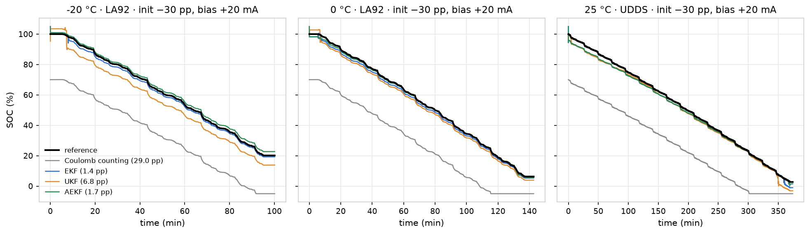
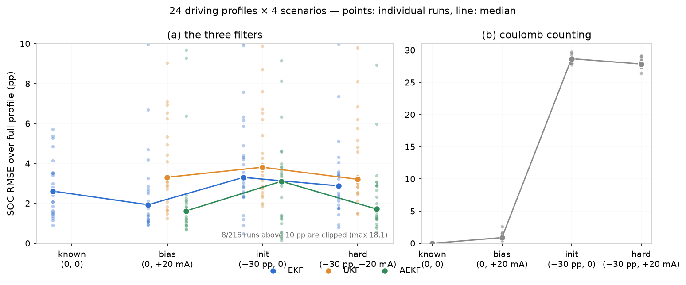

<div align="center">

# 你的 SOC 到底错多少，为什么？

### 可复用的 EKF / UKF / AEKF 电池 SOC 估计包——24 条行车工况（−20 °C ~ 25 °C）留一标定基准

[](https://github.com/ilo-love7/battery-soc-ekf-ukf/actions/workflows/ci.yml)
[](LICENSE)


<p align="center">
  <a href="./README.md">English</a> · <b>简体中文</b>
</p>

<p align="center">
  
</p>

</div>

---

一个接口、四个估计器（`CoulombCounter`、`EKF`、`UKF`、`AEKF`），以及一个不肯自我美化的基准：24 条行车工况 × 4 个压力场景 × 2 种化学体系的留一标定。README 里每个数字都由命令再生。

```
                                tail RMSE / full RMSE  (百分点)
  场景 (初值误差, 电流偏置)             CC        EKF       UKF      AEKF
  known      (  0 pp,    0 mA)        0.01/0.01  2.80/2.62    –        –
  bias20ma   (  0 pp,  +20 mA)        1.33/0.90  1.55/1.93 3.39/3.31 1.32/1.63
  init30     (−30 pp,    0 mA)       25.37/28.68 3.89/3.31 4.18/3.81 2.95/3.11
  hard       (−30 pp,  +20 mA)       24.65/27.86 2.23/2.88 3.14/3.21 1.79/1.72
```

**部署滤波器之前值得先知道的四件事：**

1. **模型误差才是地板，不是滤波器。** 初值完美、电流传感器完美时，EKF 仍有 2.62 pp，而纯库仑计数只有 0.01 pp——库仑计数从不看模型。滤波器的职责不是"准"，而是**阻止模型误差变成 SOC 误差**。
2. **滤波器唯一买到的是"初值错了"。** −30 pp 时 EKF 比库仑计数好 8.7×；但 20 mA 电流偏置下，普通库仑计数（0.90 pp）**打败** EKF（1.93 pp）。分流器好，积分很难输。
3. **AEKF 一致地赢**（全程 1.63–3.11 pp，尾段 1.32–2.95 pp），`hard` 场景 92% 工况 60 s 内收敛（EKF 50%、UKF 21%）。但 `init30`（只有初值误差）上只比 EKF 好 0.2 pp——**自适应量测噪声修的是偏置，不是初始化**。
4. **UKF 没有系统性优势**：修掉两个真实 bug 之后（见《UKF 为什么没有优势》），它在三个可比场景都略差于 EKF。修完才值得发表对比。

---

## 数据

| 数据集 | 角色 | 许可 | 位置 |
|---|---|---|---|
| Panasonic 18650PF（Kollmeyer, McMaster/UW-Madison） | 主基准：NCA，24 条行车工况，5 个温度组，HPPC | CC BY 4.0 | `PANASONIC_ROOT`（Mendeley doi 10.17632/wykht8y7tg.1） |
| CALCE A123 26650（UMD） | 跨化学体系迁移：LFP 老化至 ~45% SOH，24 段，−10…50 °C | 公开（UMD） | `CALCE_ROOT`（A123_*.zip） |

两者都从本地路径读取（`src/bmsoc/io_panasonic.py`、`scripts/10_calce_prepare.py`）；测试永远不需要数据集。

## 特性

- **四个估计器一个接口**——`CoulombCounter`、`EKF`、`UKF`、`AEKF`，都是 `run(profile) -> dict of arrays`。预测/量测模型相同，对比是诚实的。
- **第 4 状态 = 电压偏置。** 持续模型偏移（本数据 20–50 mV）在线估计而不是被 SOC 吸收。仅此一项把 `known` 地板从 3.87 → 2.15 pp。
- **温度感知 OCV。** `OCV(SOC, T)` 逐步用实测电芯温度——这些测试在行车中降温 30 K，单温度表会差几十 mV。
- **SOC ∈ [0,1] 之外线性外推**——UKF 必需，对 EKF 无害（见《UKF 为什么没有优势》）。
- **留一工况标定** + **四个压力场景**，而不是一个好看的数字。
- **154 项单元测试全部用合成数据**——CI 里不需要数据集（Python 3.10 + 3.12）。

## 结果

### 标定质量（留一工况，24 折）

| 温度 | 留出工况上的开环电压 RMSE | 中位数 |
|---|---|---|
| 25 °C | 17.3 – 48.7 mV | 27.5 mV |
| 10 °C | 29.1 – 74.1 mV | 40.7 mV |
| 0 °C | 28.5 – 81.8 mV | 40.2 mV |
| −10 °C | 39.8 – 111.6 mV | 59.1 mV |
| −20 °C | 77.9 – 196.8 mV | 98.6 mV |

中位数 **52.6 mV**，P90 **99.8 mV**。每折拟合 6 个电气参数；OCV 表**从不**参与重拟合（只来自 HPPC 静置段），所以这是真正的工况外测试。每个温度下最差的折都是 US06——最激进的电流工况。

### SOC 精度

含收敛占比与 P90 的完整表见 `reports/基准评测报告-A4.md` §7。最难场景（`hard`：−30 pp 初值 + 20 mA 偏置）的分温度中位数：

| | −20 °C | −10 °C | 0 °C | 10 °C | 25 °C |
|---|---|---|---|---|---|
| CC | 29.07 | 28.35 | 27.48 | 27.76 | 27.53 |
| EKF | 1.76 | 3.23 | 2.35 | 4.06 | 2.48 |
| UKF | 5.16 | 3.34 | 3.23 | 3.19 | 2.68 |
| AEKF | 1.71 | **1.31** | **1.21** | **2.91** | 2.61 |

温度依赖**非单调**：10 °C 最差（EKF 4.06 pp），因为 10 °C 文件从 23.7 °C 降到 12 °C——跨度最大——而折参数按单温度拟合。且 10 °C 下**五条**工况都落在 3.4–4.3 pp，是系统性偏移不是野点。**精度由模型误差 ÷ OCV 斜率决定——两者在低温一起变大，所以低温不自动变容易。**

<p align="center">
  
</p>

图集：`docs/figures/`——OCV 表与可观测性、LOO 残差、SOC 跟踪、误差分布、偏置状态收敛、敏感性、误差 CDF。

### 跨化学体系：LFP（CALCE A123）

同一套估计器、同一组超参、同样四个场景，**原封不动**跑在第二个数据集上——24 段、8 个温度（−10…50 °C），只换数据层。完整章节见 `reports/基准评测报告-A4.md` §10。

| 场景 | cc | EKF | UKF | AEKF |
|---|---|---|---|---|
| `known` (0, 0 A) | 0.01 | **0.24** | – | – |
| `bias20ma` | 2.16 | 1.96 | 1.87 | 1.95 |
| `init30` | 28.13 | 0.99 | **0.56** | 1.10 |
| `hard` | 26.90 | 1.35 | 1.98 | **1.29** |

LFP 在这里**并不更难**（0.2–2.0 pp vs NCA 的 2.6–3.3 pp），原因可测而非侥幸：

- 每段从 100% SOC 起步，那里 LFP 曲线陡（30 pp ↔ 285 mV）；
- 平台区的 SOC 增益极小——`K_soc` 0.0002 vs NCA 的 0.0046，23×——所以模型误差和 OCV 表误差都推不动估计值。

两种化学体系上真正咬人的是**容量**误差：5 % → 2–4.5 pp，10 % → 5–7.4 pp，且增益型误差没有任何滤波器状态能吸收。相比之下 ±40 mV 的 OCV 表误差（常数或 SOC 形状）只花 ≤ 0.6 pp——偏置状态吸收了它。

## 快速开始

```bash
git clone https://github.com/ilo-love7/battery-soc-ekf-ukf.git
cd battery-soc-ekf-ukf
python -m venv .venv && .venv/Scripts/pip install -r requirements.txt   # Windows
# numpy pandas pyarrow scipy openpyxl matplotlib pytest

python -m pytest tests -q                        # 154 项，不需要数据集
```

```python
import sys; sys.path.insert(0, "src")
import numpy as np, pandas as pd
from bmsoc.ecm import RCParams
from bmsoc.filters import EKF, AEKF, FilterConfig
from bmsoc.ocv import OCV2D, OCVCurve, OCVTable, from_rest_points
from bmsoc.profiles import DrivingProfile

# 1) OCV 表（也可以直接读 results/metrics/ocv_panasonic.json）
soc = np.linspace(0, 1, 11)
curve = from_rest_points(soc, 3.1 + 1.0 * soc, temp_c=25.0)
ocv2d = OCV2D(OCVTable({25.0: curve}))

# 2) 行车工况：t_s / current_a / voltage_v / temp_c / soc_ref / capacity_ah
prof = DrivingProfile(t_s=np.arange(n) * 1.0, current_a=i, voltage_v=v,
                      temp_c=np.full(n, 25.0), soc_ref=soc_ref, capacity_ah=2.77)

# 3) 估计
est = EKF(ocv=ocv2d, params=RCParams(r0=0.030, r1=0.008, tau1=12.0,
                                     r2=0.060, tau2=2000.0, dv=0.0),
          capacity_ah=2.77, cfg=FilterConfig(soc0=0.70, sigma_soc0=0.20))
out = est.run(prof, current_bias_a=0.02)
out["soc_hat"], out["bias_hat"], out["sigma_soc"]
```

## 用你自己的数据

只需要一个 `DrivingProfile`。`bmsoc.profiles.build_profile(t_s, current_a, voltage_v, temp_c, capacity_ah, soc0=1.0, dt=1.0)` 把任意不规则日志重采样到固定网格，并用库仑计数构造参考 SOC。

**符号约定：充电为正、放电为负。** 如果你的记录仪反过来，把电流**和** OCV 曲线方向一起翻过来，否则滤波器会开心地收敛到垃圾值。

## 方法要点

```
HPPC 脉冲 ──► OCV(SOC,T) ─┐
                          ├──► 2-RC 参数 ──► 留一标定 ──► 滤波器 ──► SOC
行车工况 ──────────────────┘  (ECM-RUL 项目)     (本仓库)     (本仓库)
```

状态 `x = [soc, u1, u2, b]`：

```
soc[k+1] = soc[k] + η·i[k]·Δt / (3600·Q)
u_j[k+1] = e_j·u_j[k] + R_j(1−e_j)·i[k],   e_j = exp(−Δt/τ_j)
V[k]     = OCV(soc[k], T[k]) + u1[k] + u2[k] + R0·i[k] + dv + b[k]
```

OCV 来自 HPPC 静置末端电压，PAVA 单调化后**以 1.5 mV 残差目标平滑**。平滑不是化妆：每个 HPPC SOC 级贡献 5 个几乎同 SOC（相差 0.005）的脉冲，其静置末端电压只差 0.6–8 mV——是重复测量不是斜率。−20 °C 时 35 对相邻点里 25 对*完全相同*（记录仪 0.1 mV 分辨率），PAVA 把曲线变成阶梯，PCHIP 过它让 `dOCV/dSOC` 在 **0.00 ~ 2.91 V/unit** 间振荡（阶梯间平坦 = 零卡尔曼增益——滤波器直接停止更新）。平滑后：**0.43–2.95**，中位/最小比从 10⁵ 降到 2.1。

RC 参数用**变量投影**辨识（τ 网格搜索，`[R0,R1,R2]` 用 NNLS），每个 SOC 级叠 **5 个倍率**——单个 10 s 脉冲分不开两个时间常数（`τ2` 顶在 5000 s 边界，`τ1` 在 5–67 s 乱跳）。

## 这批数据里的三个坑

**1. 重采样把 55% 的电压样本填成了错值。** 低温文件以 60 s 记录的 2 h 温箱静置开头。重采样到 1 s 后每 60 个格子空 59 个，填充逻辑用了*全部有效电压的均值*而不是前值。4.17 V 的静置在 12850 个样本里的 7080 个变成了 3.47 V，EKF 发散到 86.9 pp。改成零阶保持后同一条工况 1.77 pp，`known` 地板从 7.05 → 2.62 pp。回归测试：`tests/test_profiles.py::test_resample_holds_value_across_sparse_gaps`。

**2. 标称温度不是电芯温度。** 10 °C 组从 23.7 → 12 °C；−20 °C 组从 16.1 → −16.3 °C。所以 `OCV(SOC, T)` 每步都用实测电芯温度查表。

**3. 容量基准必须统一。** OCV 的 SOC 轴和参考 SOC 必须用同一个 `Q_ref`（HPPC 全放电：25/10/0/−10/−20 °C 分别 2.773 / 2.622 / 2.476 / 2.330 / 2.182 Ah）。混用会产生 133 mV 的"模型误差"，纯属记账问题。另外：工况裁剪为最多保留 300 s 前置静置，否则 55% 样本的平坦浸泡会稀释每一个 RMSE。

## UKF 为什么没有优势

两个真实 bug，自己实现 UKF 都值得知道。

**(a) `wm[0] = 0` 但 `wc[0] = β = 2`。** `alpha=1, kappa=0, n=4` 时 `λ = 0`，中心 sigma 点在均值里权重 0、协方差里权重 2。线性量测下相互抵消；非线性时 `dY[0]` *就是*无迹变换的均值偏置，`wc[0]·dY[0]²` 撑大 `S`：

| SOC | σ=0.05 | σ=0.20 | σ=0.30 |
|---|---|---|---|
| 0.50 | +1.4 mV | +9.4 mV | +10.8 mV |
| 0.90 | −1.1 mV | +13.5 mV | **+26.5 mV** |

σ=0.30 时是 `2·0.027² = 1.5e-3` 对 `R = 1e-4`：`S` 撑大 ~15×，增益压低一个量级。足以让 UKF 变钝，**不足以**解释 60 pp 的误差。设 `β=0` 对 `init30` 有帮助（62 → 36 pp）但对 `known` 没有。它不是这里的主因。

**(b) OCV 表在 SOC ∈ [0,1] 之外被钳位——真正的元凶。** μ=1.0、σ=0.05 时一半 sigma 点落在 1 之外，那里 `OCV` 被钳位，于是 `E[OCV(soc)] < OCV(1.0)`；新息持续为正，估计被推进 `1.05` 裁剪。SOC ≈ 0 处效应反向。一旦上轨，钳位区内的 `dOCV/dSOC` 为 0——雅可比消失，状态从*被推错*变成*动不了*：棘轮式远离真值。EKF 只在 μ 处求导，从未察觉。修复：**按边缘斜率线性外推**（同 OCV 表、同折参数、同噪声种子）：

| 工况 | 场景 | 钳位（修前） | 外推（修后） | EKF |
|---|---|---|---|---|
| −20 °C NN | known | 58.97 | **2.19** | 3.52 |
| −20 °C NN | init30 | 62.21 | **2.56** | 2.58 |
| −20 °C LA92 | bias20ma | 40.18 | **6.94** | 4.18 |
| 0 °C NN | known | 17.28 | **6.01** | 2.82 |

复现：`python scripts/07_ukf_clip_ab.py`。

> UKF 的卖点是"不用雅可比"，代价是对量测函数*全局*形状敏感。在 OCV 表上——局部平滑、边界硬钳位——EKF 就是更稳健。用 UKF 就让 `h` 在整个 sigma 支撑上平滑。

## 复现完整流程

```bash
export PANASONIC_ROOT=".../Panasonic_18650PF"
python scripts/00_recon_data.py --which pan      # 数据勘察
python scripts/02_identify_ocv_ecm.py            # HPPC 辨识 OCV + RC
python scripts/03_fit_ecm_cycle.py --dt 2        # 留一标定，约 40 s
python scripts/04_benchmark_soc.py --dt 1        # 24 工况 × 4 场景，约 9 min
python scripts/05_sensitivity.py --dt 1          # 初值/偏置/噪声扫描，约 20 min
python scripts/06_figures.py                     # docs/figures/*.png

# LFP（CALCE A123）—— CALCE_ROOT 指向 A123_*.zip 所在目录
python scripts/10_calce_prepare.py               # C/20 OCV + 24 留一折，约 5 s
python scripts/11_calce_benchmark.py --dt 1      # 24 段 × 4 场景，约 7 min
python scripts/12_calibration_stress.py --dataset calce      # 标定余量，约 7 min
python scripts/12_calibration_stress.py --dataset panasonic  # NCA 同款探针，约 8 min
python scripts/13_calce_figures.py               # 三张跨化学体系图

# v1.2–v1.10 深化轮次——见下方"再往深处"
python scripts/14_mid_soc_stress.py --dataset calce       # 约 7 min
python scripts/15_capacity_q.py --dataset panasonic       # 约 6 min
# …完整分阶段命令清单见 reports/基准评测报告-A4.md"复现指南"
python -m pytest tests -q                        # 154 项，不需要数据集
```

## 目录结构

```
src/bmsoc/        核心包：ecm / filters（EKF, UKF, AEKF）/ ocv / profiles / io_panasonic
scripts/          00–35 分析流水线（勘察 → 辨识 → 基准 → 深化轮次）
tests/            154 项合成数据单元测试（不需要数据集）
reports/          基准评测报告-A4.md（完整表，§7/§10）
results/metrics/  本文每个数字的 JSON/parquet 出处
docs/figures/     README 配图
```

## 局限与负结果

- **两种化学体系不是受控对比。** NCA（Panasonic NCR18650PF）与 LFP（CALCE A123，老化至 ~45% SOH）在电芯、年龄、工况长度、温度网格上都不同，§10 只声称"方法可迁移"，从不声称"LFP 更容易"。且"迁移"有明确前提：**从 100% SOC 起步**（平台中段上电难 15–30 倍，见"再往深处" v1.2）。
- **容量不确定性主导误差预算，在线辨识只在条件下有效。** 5–10% 容量误差花 3–7 pp（增长律逐点验证）；真实数据上容量滤波器状态会吸收模型残差反而更差。退出条件：残差压到 20 mV 以下（LFP 的 ΔOCV）——此时 EKFQ 从 5% 高估起步胜过固定容量（1.63 vs 2.44 pp）；NCA（41.7 mV）不合格。滤波后残差约束：**white ≤ ~10 mV、odd ≤ ~5–10 mV**。外部锚点路线已规格化（A2：偏置 ≤ ±2%、陈旧度 ≤ 4%）但尚未接入真实 SOH 估计器。
- **OCV 需要静置——LFP 还需要动态形状重标。** 表在沉降静置处自洽（gap ≤ 13.5 mV）；低温 `dv`（达 −138 mV）是*体制*不一致，开环 SSE 的 34% 是口径假象。LFP 的 C/20 *形状*在动态下是错的（185 mV）；`ShapeCorrected` 能修（37.4 → 17.6 mV）但还不是默认步骤。NCA 的动态残差是分布外低温大功率（US06 −20 °C，达 242 mV）。
- **加 RC 支路不降残差——静态电流形状修正也不降。** 第三支路 + 电流相关 R0 只改 LOO 残差 0–1.9%（参数顶边界 = 模型族错了）；静态 Δ(i)/BV 形状修正让它*更差*（42.1 → 45.0 mV）。大功率残差取决于**温度历程**（自加热）；逐步 R(T_meas) 是有效修复（us06 尾部 −58%，EKF 中位 −26%）。
- **电流偏置是给定的，不是估计的。** 滤波器只能靠电压反馈抵消（第 5 个偏置状态在平台上与 SOC 共线，不可观）。
- **收敛数字略偏乐观**：保留了 300 s 静置窗；且每段从 100% SOC 起步，初值误差落在陡 OCV 斜率上。

## 再往深处

<details>
<summary>v1.2 · 压力测试：中段上电 + 在线容量估计（EKFQ）</summary>

**中段上电。** 把每段切到 SOC 0.7 / 0.5 / 0.3 起步后图景全变：LFP `init30` 从 0.56–1.10 pp 恶化到 **12–36 pp**（NCA：3.3 → 10–25 pp）。即便初值*正确*误差也涨 2–3×——平台启动的纯可观测性地板。且误差不对称：偏高 30 pp 比偏低难恢复约 2×。结论："LFP 不更难"是**满充起步**的性质，不是化学体系的性质。

**在线容量估计。** 增长律 `err_end = −(1/s−1)(1−SOC_end)` 逐点验证（24 段 × 5 容量比，中位偏差 0.05 pp）。EKFQ 在合成数据上有效（10% 误差 → ±2%），真实数据上**比不作为更差**：12 pp vs 2.6 pp——38–53 mV 模型残差在电压上与慢容量漂移不可区分。

</details>

<details>
<summary>v1.3 · 老化耦合与外部 SOH 锚点（A2 接口）</summary>

`SoHSchedule`：分段常值 `Q̂(t)`/`R̂0(t)`，刷新之间零阶保持。容量误差律精确推广到漂移容量。A2 规格：**SOH 偏置 ≤ ±2%**、**陈旧度（漂移率 × 刷新周期）≤ 4%**——0.18 %/h 不刷新的 SOH 在 2 h 深放上花 13.8 pp。刷新只修积分*速率*——累积误差需要 SOC 参考事件重算。R̂0 翻倍：NCA +8.2 pp、LFP 仅 +1.4；低估 R0 便宜，高估不便宜。

</details>

<details>
<summary>v1.4 · 残差解剖与 EKFQ 复验——四个假设被数据杀了三个</summary>

充放电滞回只值 4.7 mV；第三 RC + 电流相关 R0 只改 LOO 残差 0–1.9%；慢残差既非极化也非热（R² ≈ 0.05）。LFP 真因：**OCV 曲线形状误差**——ΔOCV(soc) 重标（严格 LOO）把残差 37.4 → 17.6 mV。NCA 残差是分布外低温大功率（41.7 mV）。EKFQ 可行性阈值：**慢残差 ≤ 20 mV**。修正 LFP 模型后 EKFQ 从 5% 高估起步胜过固定容量（1.63 vs 2.44 pp）；NCA 负结果不变。判词变为"**残差 ≤ 20 mV 时 EKFQ 有效**"——条件工具；外部 SOH 锚点仍是默认路线。

</details>

<details>
<summary>v1.5 · 残差二压与热判决</summary>

BV 饱和是真的（HPPC 起始电阻随倍率收缩；−20 °C 10 A 时为低倍率值的 59%）但静态饱和形状修正不迁移（42.1 → 45.0 mV，更差）。原因：us06 −20 °C 电芯温度摆动 **20 K**，残差跟踪 2.54 mV/(K·A)·dT·i（R² = 0.66）——**自加热参数失配**。逐步 R(T_meas) 粉碎 us06 尾部（181 → 74.6 mV），EKF 中位 3.21 → 2.39 pp（−26%）。按残差*结构*修订 EKFQ 边界：慢/偶 ≤ 20–30 mV、奇（∝ i）≤ 10–15 mV——奇部毒化 q 快 4×，结构性重释 NCA 的 EKFQ 失败。

</details>

<details>
<summary>v1.6 · 冷温小电流地板解剖（H20/H21/H22）</summary>

−20 °C 工况开头静置段读数 e ≈ dv ≈ −122 mV 恒定 300 s，而 OCV 表在去掉 dv 后与实测静置吻合到 +4.4 mV：**小电流 SSE 的 34% 是体制混合的口径假象**。工况末 300 s 静置确实未收敛：另外 11% 是*状态*。剩余 55% 是真实动态地板（−20 °C 45.9 mV）。判词：**H20（表不自洽）否决**（gap ≤ 13.5 mV）、**H21（dv 体制混合）部分证实**、**H22（共享结构）否决**（LOO 迁移失败）。开环地板**不是**滤波器地板——只有 55% 那块进误差预算。

</details>

<details>
<summary>v1.7 · 滤波后残差口径的 EKFQ 复验（H23/H24/H25）</summary>

状态吸收 −20 °C 的 33%；滤波后余量几乎无慢成分（≤ 4.6 mV——v1.2 的"20 mV"前提不适用于滤波后口径），由 **white / 快非线性（29–64 mV）** 加低温超带的奇部（中位 23.4 mV）主导。选择性注入台架：**H24"奇部是主通道"否决**（仅奇部收敛 38%）、**H25"white 是主通道"部分证实**（仅 white 0%——杀死每一折）。全量回放精确复现真实失败（q̂ +38.6%、SOC 16.1 pp）。可行性：**white ≤ ~10 mV、odd ≤ ~5–10 mV**；无 NCA 折进入可行域。

</details>

<details>
<summary>v1.8 · white 分量的物理辨识（H26/H27/H28）</summary>

**H26"缺失快极化"证实**（ACF1 +0.60、高/低 |di/dt| 比 3.33；τ = 5 s 残差化快 RC 解释 white 的 R² = 0.38，砍 21% RMS）。H27 滞回仅边缘；H28 量测噪声**否决**（超额峰度 +7.7…+30.3）。物理身份：驱动电流是 ~0.5 A/s 斜坡不是阶跃——斜坡期间表观 dV/di 达 150–300 mV/A = 稳态 r0 的 2–2.4×。white 是斜坡与边缘上的缺失快极化（τ ≈ 5–10 s），低温放大。

</details>

<details>
<summary>v1.9 · 快支路出口的实测边界（H29/H30/H31）</summary>

**H29"快支路砍 white"否决**：3rc_fast 重拟合恰好砍 **0%**（τ3 在 4/5 冷折塌缩到 0.5–1 s 边界；β 跨折变号）。H30 部分：快分量是充分毒物（单独注入收敛 25%）但不是主体。H31（v/i 采样对齐）否决：δ̂ 处处亚采样。归因更新：white 的主体**不是**缺失快 RC（折先知上限 20%）——折特异非 RC 结构接管。

</details>

<details>
<summary>v1.10 · 重尾 white 的滤波器侧处理（H32/H33/H34）</summary>

滤波后残差峰度 6.5–29.3，3σ 尾能量占比 **35–52%**（高斯：2.9%）。**H32 部分**：gate3 砍中位 |q̂| 84%、SOC 比 0.19，但 q_ok 顶到 25%（线 30%）。**H33 成立**：winsorise 顶 5% 移除 27% 毒性，高斯化（同方差）移除 **64%**——毒物是重尾的*形状*不是方差。**H34 被护栏否决**：中位 SOC 改善 6%，但一折爆到 **+400%**（cap_scale=0.95——鲁棒更新裁掉了会修正容量的持续新息）。鲁棒 EKFQ 是**条件出口**，绝不盲目开启。

</details>

## 引用与许可

MIT。使用本代码请同时引用数据集：

> Kollmeyer, P., et al. *Panasonic 18650PF Li-ion Battery Data.* McMaster University / UW-Madison.
> https://doi.org/10.17632/wykht8y7tg.1

```bibtex
@misc{bmsoc2026,
  title  = {bmsoc: EKF/UKF/AEKF state-of-charge estimation with leave-one-profile-out benchmarking},
  year   = {2026},
  url    = {https://github.com/ilo-love7/battery-soc-ekf-ukf},
  note   = {Reference implementation, 1.7--3.1 pp SOC RMSE at -30 pp initial error}
}
```
